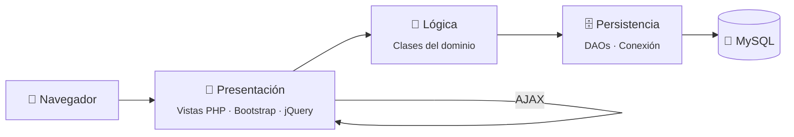
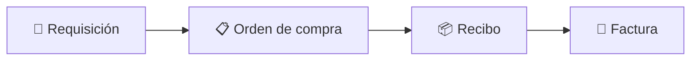
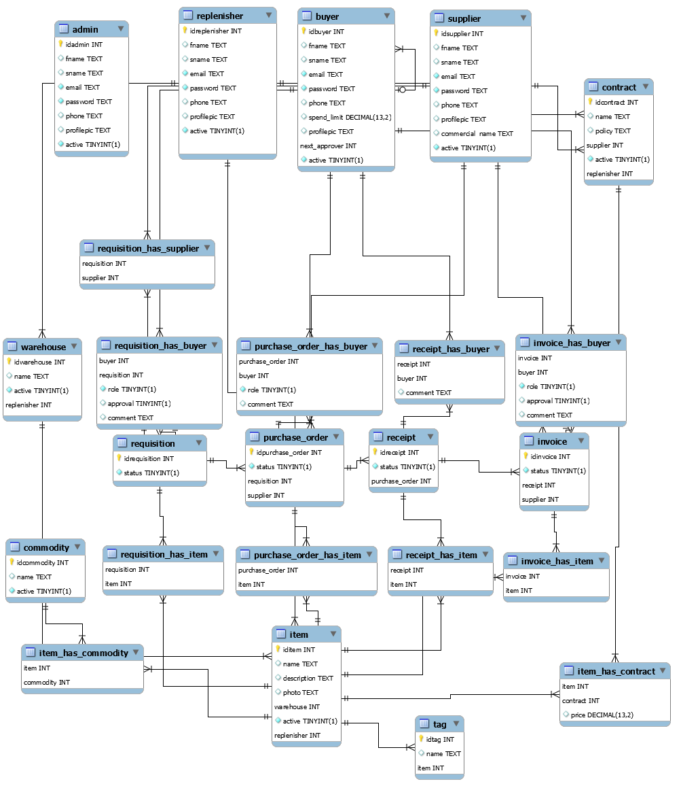

<div align="center">

# 🐘 PHP Playground

**Mi espacio para jugar, romper cosas y aprender PHP.**

Aplicaciones web hechas con PHP puro, sin frameworks: del registro de pacientes de una IPS a un sistema de compras con varios roles.


</div>

---

## 🧭 ¿Qué es esto?

Este repositorio no es un producto: es una **bitácora de aprendizaje**. Aquí están los proyectos con los que aprendí a construir aplicaciones web "a mano": sesiones, formularios, conexión a MySQL, AJAX y reportes en PDF. Todo con PHP puro, para entender lo que los frameworks como Laravel o Symfony hacen por debajo.

La idea es simple: **probar, equivocarse, aprender y dejar registro.**

---

## 🏛️ La arquitectura que se repite

Los dos proyectos separan el código en capas, de forma parecida a MVC:



---

## 📂 Estructura

```
php-dev/
├── 🏥 proyecto-final-PHP/   # IPS: registro y gestión de pacientes
└── 🛒 proyecto_final/       # Coupa: sistema de compras con 4 roles
```

---

## 🏥 `proyecto-final-PHP/` — Registro de pacientes de una IPS


Aplicación para registrar y administrar los pacientes de una IPS (institución prestadora de salud).

- 🔐 Inicio de sesión de **administradores** con sesiones de PHP
- 📝 Registro, consulta y edición de pacientes
- 🖼️ Subida de **foto de perfil**
- ⚡ Activar o desactivar pacientes con **AJAX**, sin recargar la página
- 🗂️ Capas: `presentacion/` → `logica/` → `persistencia/`

---

## 🛒 `proyecto_final/` — Coupa: sistema de compras

Un sistema de **gestión de compras** (*procurement*), inspirado en Coupa. Cada tipo de usuario tiene su propio panel:

| Rol | Qué hace |
|---|---|
| 👑 **Admin** | Supervisa solicitudes, órdenes, recibos y facturas, y la configuración |
| 🛍️ **Buyer** | Crea requisiciones y las aprueba según su límite de gasto |
| 📦 **Replenisher** | Gestiona bodegas, ítems y contratos |
| 🏭 **Supplier** | Se registra y atiende las requisiciones y órdenes de compra |

El flujo de una compra:



- 📊 Gráficas de requisiciones y órdenes de compra con **Chartkick + Google Charts**
- ⚡ Tablas y gráficas que se cargan por **AJAX**
- 📄 Reportes en **PDF** generados con **FPDF**
- 🗄️ 13 entidades, cada una con su clase de lógica y su **DAO**

### 🗺️ Modelo entidad-relación



---

## ▶️ Cómo correr los proyectos

<details>
<summary><b>🐘 Con XAMPP</b></summary>

1. Instala [XAMPP](https://www.apachefriends.org/) y arranca **Apache** y **MySQL**.
2. Copia la carpeta del proyecto dentro de `htdocs/`.
3. Crea la base de datos en **phpMyAdmin**:

   | Proyecto | Base de datos | Script |
   |---|---|---|
   | IPS | `ipsud` | `proyecto-final-PHP/persistencia/ipsud.sql` |
   | Coupa | `coupa` | `proyecto_final/models/coupa.sql` y luego los `INSERT` de `proyecto_final/models/information` |

4. Abre `http://localhost/<carpeta-del-proyecto>/`.

La conexión usa el usuario por defecto de XAMPP (`root` sin contraseña). Se cambia en `persistencia/Conexion.php` o `persistent/Connection.php`.

Los modelos `.mwb` se abren con **MySQL Workbench**.

</details>

---

## 📝 Notas

Son proyectos **académicos**, hechos para aprender. Revisándolos hoy, varias cosas se harían distinto en producción:

- 🔑 Las contraseñas se guardan con `md5()`; hoy se usaría `password_hash()`.
- 💉 Las consultas SQL se arman concatenando texto; hoy se usarían **sentencias preparadas** para evitar inyección SQL.
- 📂 La navegación incluye archivos a partir de un parámetro de la URL; hoy se usaría una lista blanca de rutas.
- 🗝️ Las credenciales de la base de datos están en el código; hoy irían en variables de entorno.

Los datos de prueba son ficticios (Pedro Picapiedra, Homero Simpson, Clark Kent…).

<div align="center">

---

Hecho con 🐘 y mucha curiosidad por **[Andrés Sierra](https://github.com/andysierra)**

</div>
